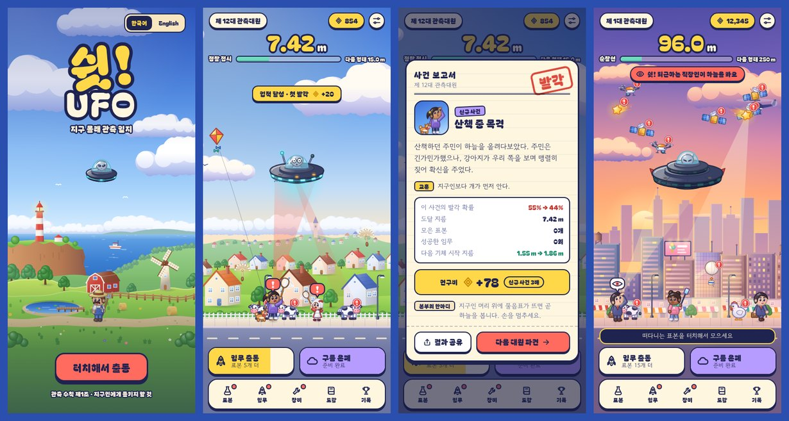

# 쉿! UFO

지구인에게 들키지 않고 지구를 관측하는 UFO 키우기 게임.
들키면 그 대원은 귀환하고, 남긴 사건 보고서 덕분에 다음 대원은 같은 실수에 덜 들킵니다.
지름 30 cm 탐사정으로 시작해 지름 15 km 은하 모선을 완성하면 관측 완료입니다.



## 게임 방법

- **표본 모으기**: 떠다니는 민들레 홀씨·반딧불이·젖소 등을 터치하면 견인 빔으로 끌어올려 기체가 자랍니다.
- **시선 피하기**: 지구인 머리 위에 `?` 가 뜨면 곧 하늘을 봅니다. 눈 표시가 떠 있는 동안 빔을 쏘면 들킵니다.
- **위험한 표본**: 느낌표가 붙은 표본(풍선, 연, 닭, 젖소…)은 모으는 순간 들킬 수 있습니다.
- **구름 은폐**: 몇 초 동안 무엇을 모아도 들키지 않습니다. 재사용 대기 시간이 있습니다.
- **임무 출동**: 표본을 모아 연료를 채우면 출동할 수 있습니다. 성공하면 크게 자라고, 실패하면 들킵니다.
- **세대 교체**: 들킨 사건은 도감에 기록되고, 그 사건의 발각 확률이 내려갑니다. 새 사건을 기록할 때마다 다음 기체가 더 크게 시작하고 연구비도 3배로 받습니다.
- **연구비**: 새 표본·임무 해금과 장비 강화(빔 증폭기, 은폐기, 시선 감지기, 수집 드론, 자동 관측 등)에 씁니다. 장비는 대원이 바뀌어도 남습니다.
- **관측 완료**: 지름 15 km 에 닿으면 엔딩. 발각 도감 38종을 모두 채운 뒤 완료하면 보고서의 추신이 열립니다.

## 담긴 것

| 항목 | 내용 |
| --- | --- |
| 기체 형태 | 8종(콩알 탐사정 → 은하 모선), 형태마다 그림이 다릅니다 |
| 관측지 | 7곳: 시골 들판, 주택가, 호숫가 캠핑장, 도심, 천문대 언덕, 구름 바다, 지구 궤도 |
| 지구인 | 11종(농부, 꼬마, 산책하는 주민, 생방송 진행자, 천문학자, 우주비행사…). 들키면 잠자리채를 들고 달려옵니다 |
| 표본 · 임무 | 표본 10종, 임무 12종 |
| 발각 도감 | 사건 38종, 사건마다 보고서·교훈·단서 |
| 장비 · 업적 | 장비 8종, 업적 27개 |
| 그 밖 | 출석 보급품, 자리 비움 성장, 저장 코드 내보내기/불러오기, 한국어·영어, 효과음·배경 음악·진동, 설치형 웹 앱(오프라인 실행) |

그림은 전부 캔버스 코드로 그리고, 소리는 Web Audio 로 합성합니다. 이미지·음원 파일이 없고 외부 서버에 접속하지 않습니다.
그림체는 맑은 낮의 3D 카툰 풍입니다. 빛은 왼쪽 위에서 오고, 외곽선은 검정 대신 같은 색 계열의 가는 선을 씁니다. 공통 색과 음영 도구는 `src/render/draw.js` 의 `P`, `shade`, `ball`, `gloss`, `cumulus` 에 있습니다.
진행 상황은 기기에만 저장됩니다(localStorage).

## 실행

Node.js 20 이상이 필요합니다.

```bash
npm install          # 빌드 도구(esbuild) 설치
npm start            # 개발 서버 http://localhost:5173
```

모듈을 그대로 불러오므로 `npm start` 없이도 아무 정적 서버로 이 폴더를 열면 됩니다.
`index.html?debug` 로 열면 브라우저 콘솔에서 `window.__ufo` 로 게임 상태를 볼 수 있습니다.

## 배포

```bash
npm run build
```

- `dist/` — 그대로 정적 호스팅(GitHub Pages, Netlify, Cloudflare Pages 등)에 올리면 됩니다. HTTPS 로 열면 서비스 워커가 등록되어 홈 화면에 설치할 수 있고 오프라인에서도 열립니다.
- `dist/shh-ufo.html` — 글꼴·스크립트·스타일을 모두 품은 파일 하나짜리 판입니다(약 0.9 MB). 웹 포털 업로드나 미리보기에 씁니다. 이 판은 설치·오프라인 기능이 없습니다.

앱 마켓(구글 플레이·앱 스토어)에 올리려면 `dist/` 를 Capacitor 나 TWA(Trusted Web Activity) 같은 웹뷰 포장 도구로 감싸면 됩니다. 이 저장소에는 그 포장 설정이 들어 있지 않습니다.

## 시험

```bash
npm test                     # 규칙·저장·문구 단위 시험(node:test)
npm run sim                  # 밸런스 시뮬레이션(가상 플레이어 200명)
npm run sim -- 200 --careful # 위험을 피하는 플레이어 유형
npm run smoke                # 실제 브라우저로 주요 흐름 30개 점검(Playwright 필요)
npm run smoke -- --dist      # 빌드 결과 점검
npm run smoke -- --single    # 파일 하나짜리 판 점검
```

`npm run smoke` 와 `npm run icons` 는 Playwright 가 필요합니다: `npm i -D playwright && npx playwright install chromium`.

### 밸런스 기준

`npm run sim` 기준(일반형 플레이어, 표본 하나에 1.35초, 보고서 읽는 데 9초로 가정):

- 첫 관측 완료까지 순수 플레이 약 70분, 약 70번째 대원, 도감 약 29/38
- 대원 한 명이 버티는 시간 중앙값: 초반 약 26초, 후반 약 40초
- 들키는 원인: 임무 약 47%, 표본 약 24%, 시선 약 23%, 특수 약 6%

수치는 `src/data/content.js`(콘텐츠 표)와 `src/core/balance.js`(공식)에 모여 있습니다. 바꾼 뒤에는 `npm run sim` 으로 흐름을 확인하세요.

## 구조

```
index.html, styles/main.css   화면 뼈대와 스타일
src/main.js                   시작, 프레임 루프, 저장 주기
src/core/                     게임 규칙(DOM 없음, node 에서 그대로 실행·시험)
  game.js                     상태를 바꾸는 모든 동작
  world.js                    화면 속 지구인·표본의 움직임과 터치 판정
  balance.js, state.js        밸런스 공식, 저장 형식과 검증
src/data/content.js           형태·표본·임무·사건·장비·업적 표
src/i18n/                     한국어·영어 문구(조사 자동 선택 포함)
src/render/                   캔버스 그림: 기체, 지구인, 표본, 엠블럼, 배경, 장면 합성
src/ui/                       계기판, 패널, 모달, 연출 순서
src/audio/audio.js            효과음과 배경 음악 합성
src/platform/                 저장, 진동, 공유, 서비스 워커 등록
sw.js, manifest.webmanifest   설치형 웹 앱
tools/                        개발 서버, 빌드, 시뮬레이터, 브라우저 점검, 아이콘·글꼴 생성,
                              그림 미리보기(artsheet.html: 기체·지구인·표본·엠블럼, stagesheet.html: 무대 배경)
tests/                        단위 시험
```

### 문구 추가하기

화면에 나오는 글은 모두 `src/i18n/ko.js` 와 `src/i18n/en.js` 에 있습니다. 두 파일의 키 구조는 같아야 하고 `npm test` 가 이를 검사합니다.
한국어 문구의 조사는 `(이)가`, `(으)로`, `을(를)`, `은(는)`, `와(과)` 로 쓰면 앞 글자의 받침에 맞춰 자동으로 골라집니다.

### 글꼴

문구에 새 글자를 넣었다면 글꼴 서브셋을 다시 만드세요(KS X 1001 완성형 2,350자와 문구에 쓰인 글자를 남깁니다).

```bash
pip install fonttools brotli
python3 tools/subset-fonts.py BagelFatOne-Regular.ttf GowunDodum-Regular.ttf
```

## 라이선스 참고

- 글꼴: [Bagel Fat One](https://github.com/JAMO-TYPEFACE/BagelFat), [Gowun Dodum](https://github.com/yangheeryu/Gowun-Dodum) — 둘 다 SIL Open Font License 1.1. 전문은 `assets/fonts/*-OFL.txt`.
- 그 밖의 코드·그림·소리는 이 저장소에서 만든 것입니다.
