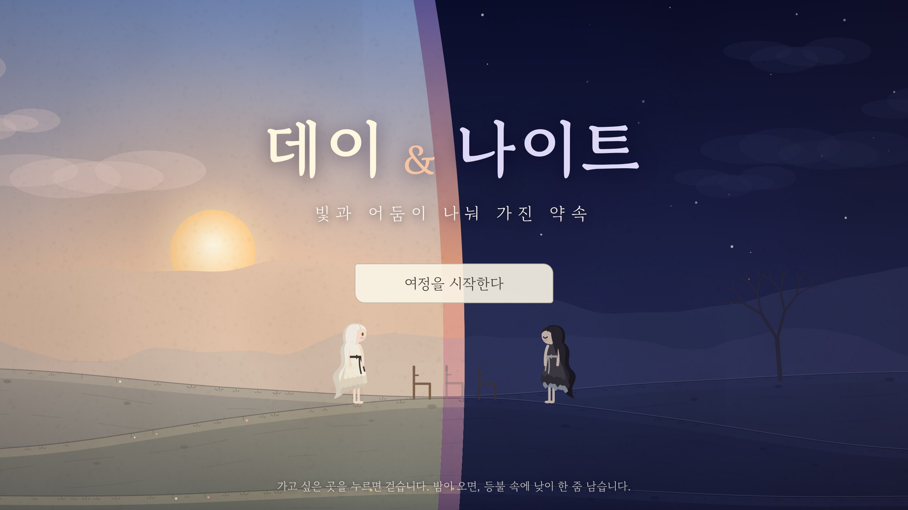
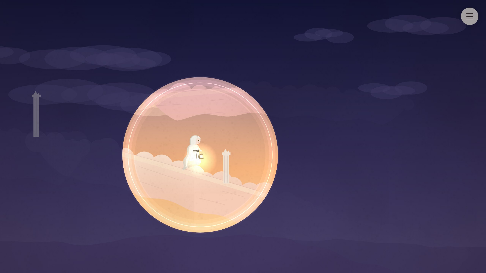
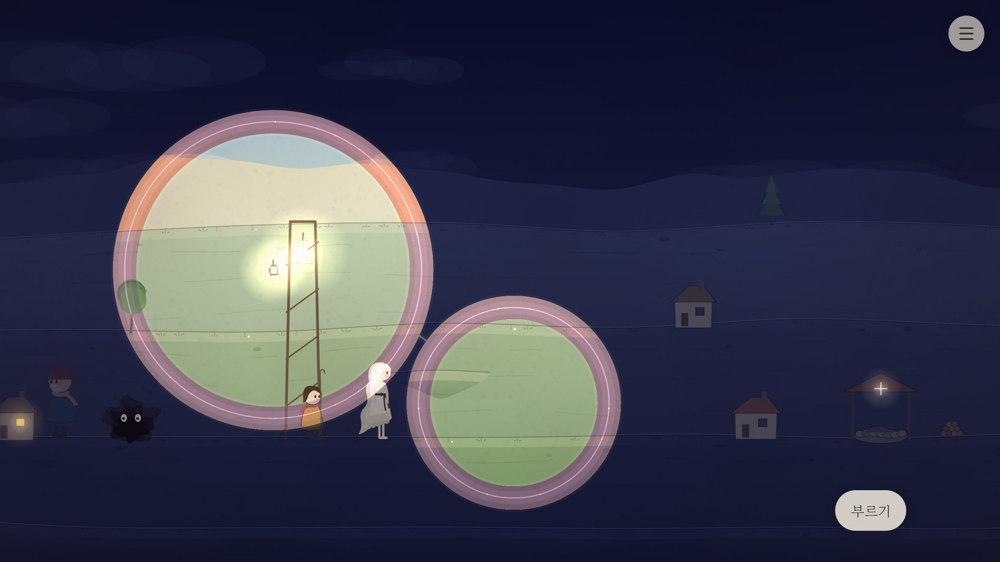
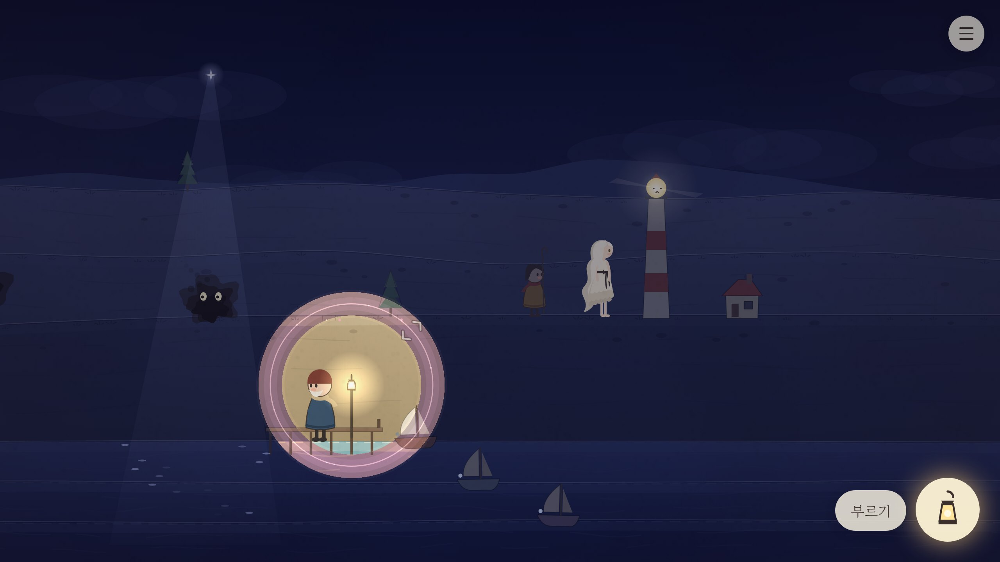
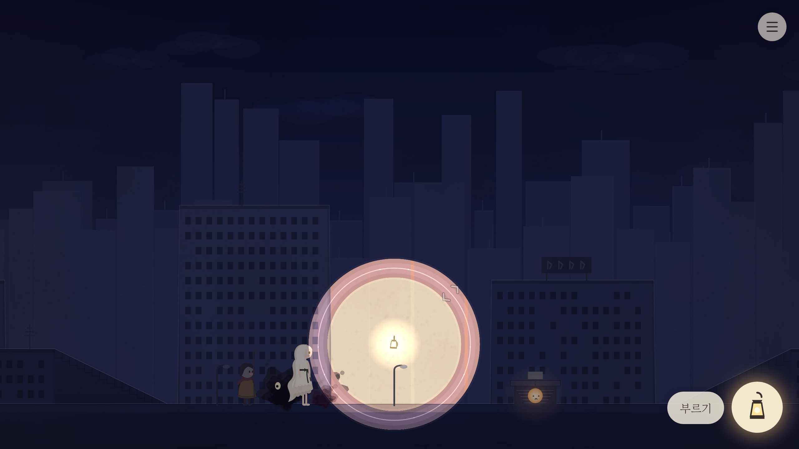
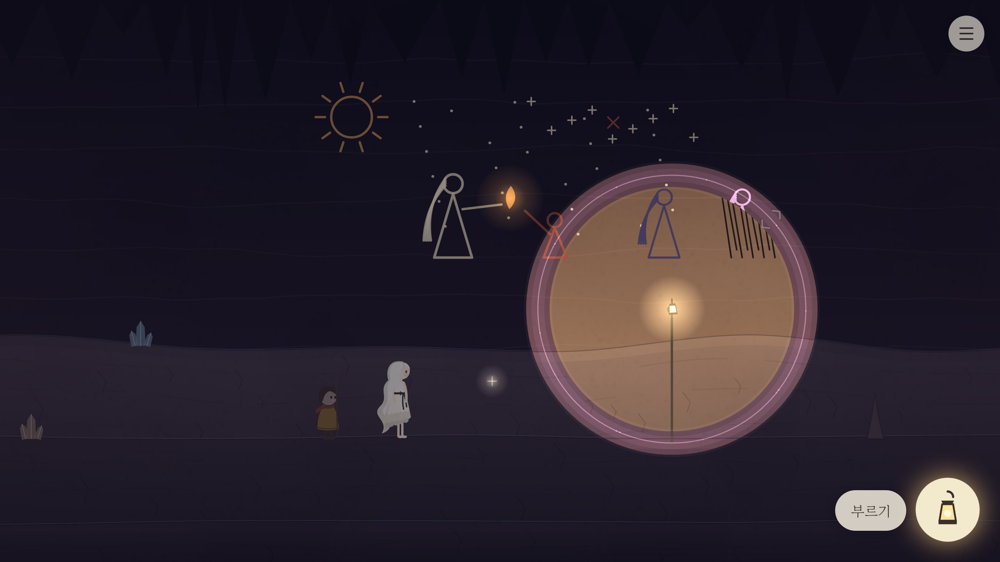
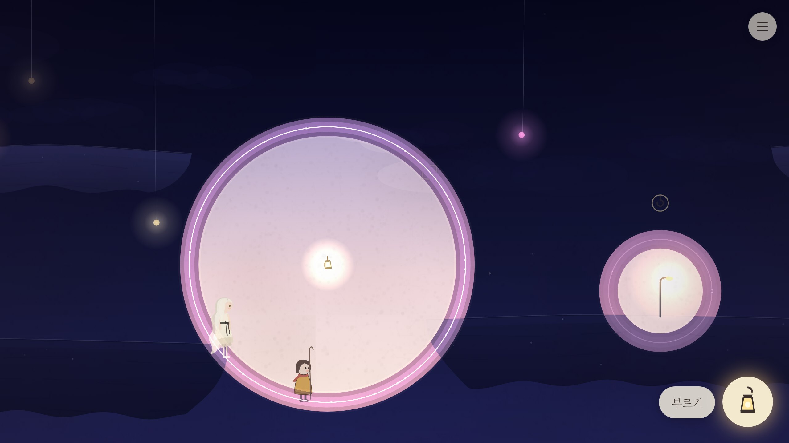
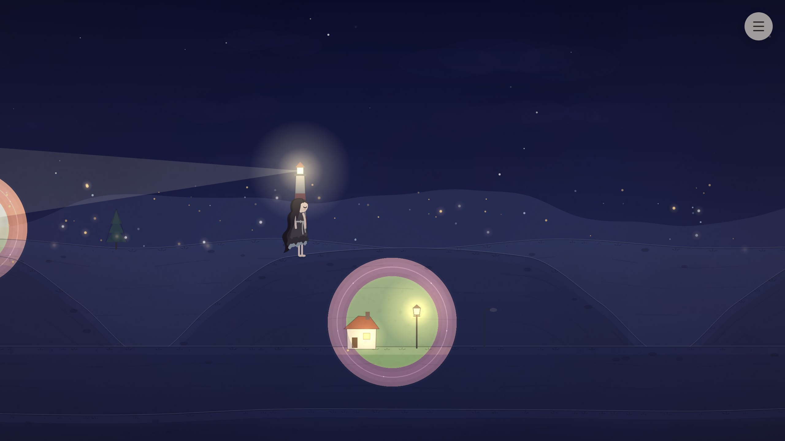
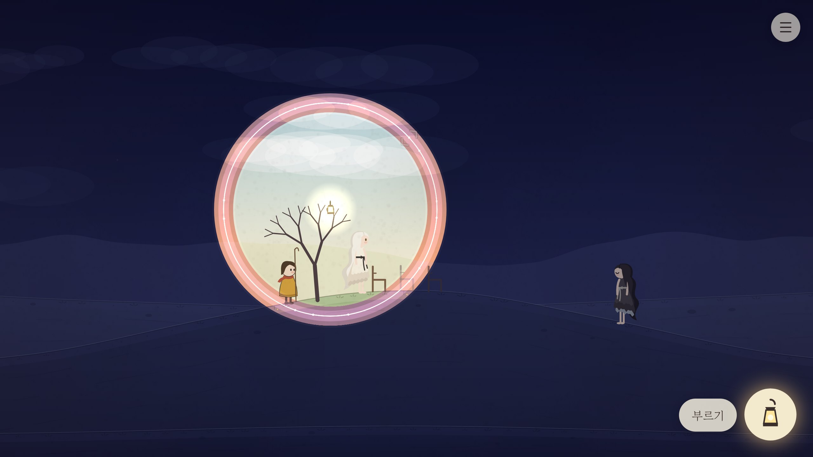

# 데이 & 나이트

빛과 어둠이 나눠 가진 약속에 대한 이야기 게임.

인간 세계에서 모든 빛이 사라진 날, 낮의 소녀 데이는 빛을 되찾으러 지상에 내려온다.
범인은 쌍둥이 동생 나이트처럼 보이지만, 여정의 끝에서 데이는 약속을 먼저 깬 것이 자기 자신이었음을 알게 된다.



## 한 줌의 낮

이 게임의 규칙은 하나다. **밤이 오면, 낮은 데이의 등불 속으로 오므라든다.**

등불 둘레의 동그란 빛 안은 낮이고, 밖은 밤이고, 그 가장자리의 얇은 띠는 황혼이다.
세 곳에서는 실재하는 것이 서로 다르다.

| | 빛 안 (낮) | 가장자리 (황혼) | 빛 밖 (밤) |
|---|---|---|---|
| 그을음 (사람들의 두려움) | 흩어진다 | 흩어진다 | **길을 막는다** |
| 빛 먹는 그을음 | **깨어나 길을 막는다** | 잠들어 있다 | 잠들어 있다 |
| 그림자 다리, 밤의 섬 | 사라진다 | 디딜 수 있다 | **단단하다** |
| 하늘 궁전의 구름 | **단단하다** | 디딜 수 있다 | 흐려진다 |
| 별, 나이트 | 보이지 않는다 | 보인다 | **보인다** |
| 기억 조각, 지워진 셋째 | 없다 | **여기에만 있다** | 없다 |

그래서 전부 밝히면 안 되고, 전부 끄면 안 된다. 등불을 들고 걷거나, 고리에 걸어 두거나, 빛의 크기를 바꿔서
지금 필요한 것이 필요한 곳에 있게 한다. 이야기의 주제 — 빛과 어둠은 나눠 가져야 하는 것 — 가 그대로 조작이 된다.

가장자리는 아무것도 막지 않는, 낮도 밤도 아닌 자리다. 이야기가 숨긴 셋째의 자리이기도 해서,
후반(과 2회차)에는 걸어 둔 등불의 **빛 가장자리 자체를 밟고** 건널 수 있게 된다.

| | |
|---|---|
|  |  |
|  |  |
|  |  |
|  |  |

## 실행

설치도 빌드도 필요 없다. `index.html` 을 브라우저로 열면 된다. 그림 파일도 없다 — 모든 것을 코드로 그린다.

## 조작

| 하고 싶은 일 | 방법 | 배우는 곳 |
|---|---|---|
| 걷기 | 가고 싶은 곳을 누른다 | 처음부터 |
| 살펴보기 | 반짝이는 것을 누른다 | 처음부터 |
| 등불 걸기 | 고리를 누른다. 빛은 그 자리에 머문다 | 1장 (하리) |
| 등불 부르기 | 걸어 둔 등불이나 `부르기` 단추를 누른다 (키보드 `R`) | 1장 |
| 빛 줄이기 · 넓히기 | 빛의 가장자리를 끈다 (마우스 휠도 된다) | 2장 |
| 빛 끄기 · 켜기 | 오른쪽 아래 등불 단추 (키보드 `L`) | 2장 |
| 둘러보기 | 화면을 좌우로 끈다 | 처음부터 |

발밑의 길이 사라지게 되는 조작(그림자 다리 위에서 불 켜기 등)은 등불이 듣지 않는다.

## 이야기 문서가 게임에서 어떻게 되었나

| 장 | 무대 | 그 장의 놀이 | 얻는 것 |
|---|---|---|---|
| 프롤로그 | 하늘 궁전 | 지는 해를 등불에 담는다. 밤이 오고, 낮이 등불로 오므라든다 | 등불 |
| 1장 | 산골 마을 | 빛으로 그을음 물리치기. 건너편 다리지기에게 빛 보내기. 종에 빛을 되비추기 | 등불 걸기, 빛 정령과 대화 |
| 2장 | 항구 | 불을 꺼야 보이는 마지막 별. 배들은 어둠 속에서 돌아오지만, 밧줄을 받을 사람에겐 빛이 필요하다 | 빛 줄이기 · 끄기 |
| 3장 | 대도시 | 그림자 다리 건너기. 그을음과 빛 먹는 그을음 사이에 빛의 가장자리 놓기 | 그림자 걸음 |
| 4장 | 잊힌 동굴 | 가장자리로 기억 조각 찾기. 어린 데이가 되어, 덮어 둔 빛을 여는 순간을 직접 한다 | 기억 조각 보기, 황혼 걸음 |
| 5장 | 밤의 영역 | 하리가 등불을 든다. 빛은 밤의 섬을 지우므로, 가장자리만 밟고 건넌다 | — |
| (5장) | 나이트의 밤 | 나이트가 되어 걷는다. 인간의 빛이 늘수록 설 자리가 줄고, 끝내 빛을 거둔다 | — |
| 최종장 | 황혼의 언덕 | 빛의 가장자리를 가운데 의자에 놓는다. 빛 정령 다섯을 두 세계에 나눈다 | 결말 |

모든 장은 문서의 리듬을 따른다: 낮에 걷고, 밤에 일이 터지고, 빛 정령을 만나 선택하고, 황혼에 나이트와 마주친다.
정령을 인간에게 돌려보내면 그 자리에 꺼지지 않는 낮이 생기고(그을음은 못 오지만 별도 묻힌다), 밤에 맡기면 어두운 채로 남는다.

### 세 축과 열한 개의 결말

- **A. 빛의 행방** — 화롯불·등대·네온·가로등·병원 야간등 가운데 인간에게 돌아간 수. 4 이상 *인간 쪽*, 1 이하 *밤 쪽*, 그 사이 *균형*. 최종장에서 다시 정할 수 있다.
- **B. 나이트와의 관계** — 황혼 타임의 대답(날 선 말 −2 / 묻는 말 +1 / 믿는 말 +2), 나이트에게 한 고백 +2, 5장의 마지막 말(두 배). 8 이상 *신뢰*, −3 이하 *적대*, 그 사이 *이해*.
- **C. 데이의 고백** — 4장에서 하리에게, 나이트에게.
- 숨은 조건 — 하리와의 유대(다섯 번의 대화 모두), 황혼의 단서 다섯 개.

| 결말 | 계열 | 조건 |
|---|---|---|
| 황혼 | 히든 | 황혼 단서 전부 + 고백 |
| 새벽 | 트루 | 균형 + 신뢰 + 고백(둘 다) |
| 별빛 시대 | 해피 | 밤 쪽 + 신뢰 |
| 점등인 | 해피 | 균형 + 하리 유대 최고 |
| 거짓 새벽 | 씁쓸함 | 균형 + 신뢰 + 고백 안 함 |
| 백야 | 씁쓸함 | 인간 쪽 + 신뢰 |
| 자리 바꾸기 | 씁쓸함 | 이해 + 나이트에게 고백 |
| 대낮 | 배드 | 인간 쪽 + 적대 |
| 긴 밤 | 배드 | 밤 쪽 + 적대 |
| 영원한 노을 | 배드 | 신뢰 + 최종장에서 "함께 있고 싶어" |
| 되풀이 | 특수 | 위 어느 것도 아닐 때. 프롤로그로 돌아간다 |

**2회차.** 결말을 한 번 보면 다음 여정에서는 황혼 걸음을 처음부터 알고 있다. 단서 다섯 중 둘(1장의 바위 턱, 3장의 광고판 위)은
빛의 가장자리를 밟아야만 닿는 곳에 있어서, 히든 결말은 2회차부터 가능하다. 나이트의 대사가 달라지고, 빛 정령들이 데이를 어렴풋이 기억하며, 선택지가 하나씩 더 열린다.

### 문서에 없거나 미정이라 임시로 정한 것

- **영원한 노을의 우선순위** — 마지막 선택이 (히든을 빼고) 다른 조건보다 앞서도록 했다. `js/story.js` 의 `Story.WISH_FIRST` 를 `false` 로 바꾸면, 다른 결말 조건이 하나도 맞지 않을 때만 영원한 노을이 된다.
- **황혼 걸음** — 문서의 능력 표에는 없다. 셋째 자매(경계의 주인)를 조작으로 미리 느끼게 하려고 4장 끝에 넣었다.
- **다리지기, 선창지기** — 문서에 없는 인물. "인간에게는 빛이 필요하다"를 퍼즐로 보여 주려고 넣었다.
- **되풀이 뒤의 하리** — 같은 아이로 두었다. **챕터 수** — 문서대로 프롤로그 + 5장 + 최종장.

## 그림

컨셉 아트는 게임에 들어 있지 않다. 그 인상 — 발목까지 흐르는 물결 머리, 민소매에 층진 치마, 허리의 리본, 맨발,
눈을 감고 고개를 숙인 나이트와 해진 치맛단 — 만 남겨 단순한 도형으로 다시 그렸다 (`js/art.js` 의 `Art.girl`).
잊힌 셋째는 같은 모습에 노을빛을 입혔다.

## 폴더

```
index.html          여는 파일
css/style.css       대화 상자, 단추, 메뉴
js/terrain.js       지형, 세 구역(낮·황혼·밤) 판정, 길찾기 (화면과 무관한 순수 로직)
js/render.js        구역마다 다른 색으로 풍경을 그려 빛의 원으로 합친다
js/art.js           데이·나이트·하리, 빛 정령, 그을음, 소품
js/game.js          입력, 등불(들기·걸기·크기), 인물 이동, 대본 실행, 저장
js/story.js         세 축, 결말 판정, 결말 장면의 대사
js/levels*.js       장면마다의 지형, 사물, 대본
js/audio.js         소리 (녹음 파일 없이 즉석 합성)
tools/              자동 플레이 검증
```

장면은 데이터다. `js/levels*.js` 에서 겹(`layers`)과 고리·그을음 같은 사물(`things`), 대본을 고치면 된다.
주소 뒤에 `?level=ch3` 처럼 붙이면 그 장부터 볼 수 있다 (`prologue`, `ch1`~`ch5`, `finale`, `memory`, `cavemouth`, `nightwalk`; `&run=2` 로 2회차).

## 자동 검증

각 장을 정해진 풀이대로 끝까지 진행하고, 퍼즐이 저절로 풀려 있지 않은지, 2회차 단서가 황혼 걸음 없이는 닿지 않는지, 결말 판정이 표와 맞는지 확인한다 (Node, Playwright 필요).

```bash
node tools/playtest.cjs
```

```bash
node tools/playtest.cjs ch2
```
