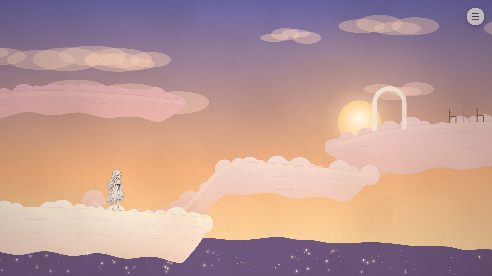
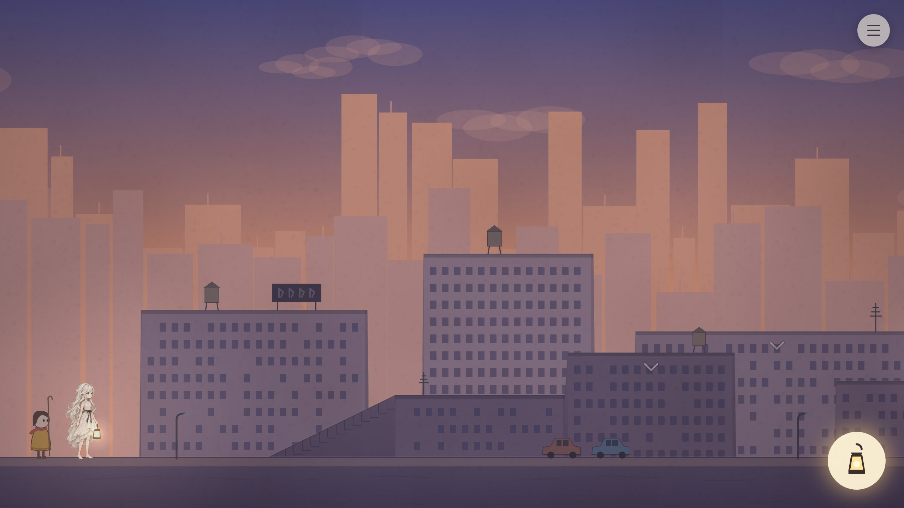
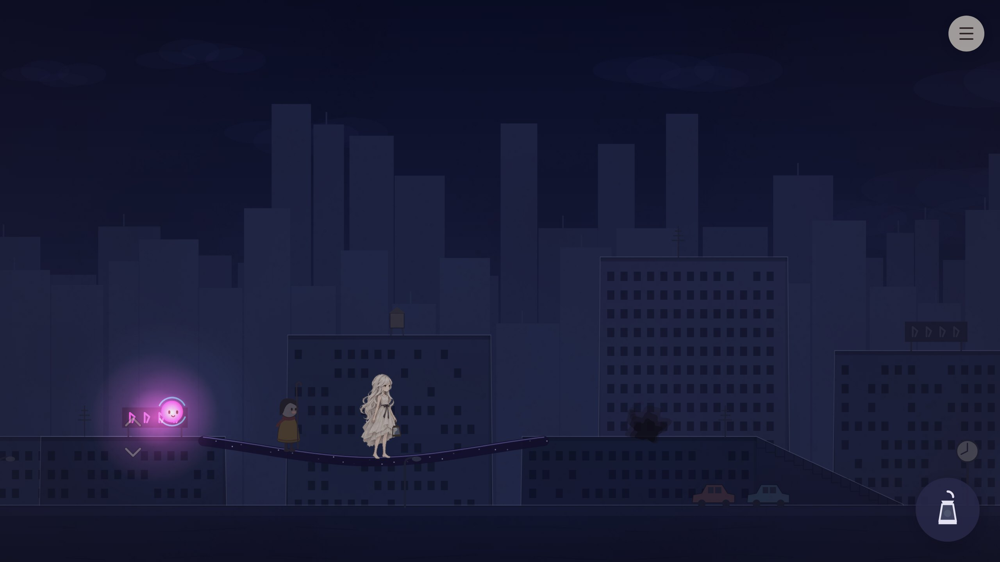

# 데이 & 나이트

빛과 어둠이 나눠 가진 약속에 대한, 언덕을 끌어 길을 잇는 이야기 게임.

인간 세계에서 모든 빛이 사라진 날, 낮의 소녀 데이는 빛을 되찾으러 지상에 내려온다.
범인은 쌍둥이 동생 나이트처럼 보이지만, 여정의 끝에서 데이는 약속을 먼저 깬 것이 자기 자신이었음을 알게 된다.


| | |
|---|---|
|  |  |
|  |  |

## 실행

설치도 빌드도 필요 없다. `index.html` 을 브라우저로 열면 된다.
(GitHub Pages 를 켜면 저장소 주소 그대로 플레이할 수 있다.)

## 조작

| 하고 싶은 일 | 방법 |
|---|---|
| 걷기 | 가고 싶은 곳을 누른다. 갈 수 있는 데까지 걸어간다. |
| 길 잇기 | 언덕(구름, 물결, 건물)을 위아래로 끈다. 두 능선이 만나는 곳에서 건너갈 수 있다. **발밑의 땅은 움직일 수 없다.** |
| 살펴보기 | 반짝이는 것을 누른다. |
| 등불 켜고 끄기 | 오른쪽 아래 단추 (키보드 `L`). 2장에서 배운다. |
| 둘러보기 | 하늘을 좌우로 끈다. |
| 메뉴 | 오른쪽 위 단추 (`Esc`). 장을 처음부터 다시 할 수 있다. |

## 이야기 문서가 게임에서 어떻게 되었나

| 장 | 무대 | 그 장의 놀이 | 얻는 것 |
|---|---|---|---|
| 프롤로그 | 하늘 궁전 | 구름 섬을 끌어 노을 언덕으로. 지는 해를 등불에 담는다 | 등불 |
| 1장 | 산골 마을 | 그을음을 등불로 흩기, 옛 종에 빛을 되비춰 짙은 그을음 걷기 | 빛 정령과 대화 |
| 2장 | 항구 | 등불을 끄면 보이는 마지막 별. 물결을 끌어 배 세 척의 물길 잇기 | 등불 끄기 |
| 3장 | 대도시 | 건물을 끌어 옥상 높이 맞추기, 빛을 먹는 그을음 피하기 | 그림자 걸음 |
| 4장 | 잊힌 동굴 | 기억 조각 셋. 어린 데이가 되어 첫 불씨를 건넨다 | 기억 |
| 5장 | 밤의 영역 | 하리가 등불을 들고 앞장선다. 나이트가 되어 별이 꺼져 가는 수천 년을 걷는다 | — |
| 최종장 | 황혼의 언덕 | 빛 정령 다섯을 두 세계에 나누고, 마지막 말을 고른다 | 결말 |

모든 장은 문서의 리듬을 따른다: 낮에 걷고, 밤에 일이 터지고, 빛 정령을 만나 선택하고, 황혼에 나이트와 마주친다.

### 세 축과 열한 개의 결말

- **A. 빛의 행방** — 화롯불·등대·네온·가로등·병원 야간등 가운데 인간에게 돌아간 수. 4 이상 *인간 쪽*, 1 이하 *밤 쪽*, 그 사이 *균형*. 최종장에서 다시 정할 수 있다.
- **B. 나이트와의 관계** — 황혼 타임의 대답(날 선 말 −2 / 묻는 말 +1 / 믿는 말 +2), 나이트에게 한 고백 +2, 5장의 마지막 말(두 배). 8 이상 *신뢰*, −3 이하 *적대*, 그 사이 *이해*.
- **C. 데이의 고백** — 4장에서 하리에게, 나이트에게.
- 숨은 조건 — 하리와의 유대(다섯 번의 대화 모두), 황혼의 단서 다섯 개.

| 결말 | 계열 | 조건 |
|---|---|---|
| 황혼 | 히든 | 황혼 단서 전부 + 고백 (단서 둘은 2회차부터 보인다) |
| 새벽 | 트루 | 균형 + 신뢰 + 고백(둘 다) |
| 별빛 시대 | 해피 | 밤 쪽 + 신뢰 |
| 점등인 | 해피 | 균형 + 하리 유대 최고 |
| 거짓 새벽 | 씁쓸함 | 균형 + 신뢰 + 고백 안 함 |
| 백야 | 씁쓸함 | 인간 쪽 + 신뢰 |
| 자리 바꾸기 | 씁쓸함 | 이해 + 나이트에게 고백 |
| 대낮 | 배드 | 인간 쪽 + 적대 |
| 긴 밤 | 배드 | 밤 쪽 + 적대 |
| 영원한 노을 | 배드 | 신뢰 + 최종장에서 "함께 있고 싶어" |
| 되풀이 | 특수 | 위 어느 것도 아닐 때. 프롤로그로 돌아간다 |

결말을 한 번 보면 다음 여정은 2회차가 된다. 나이트의 대사가 달라지고, 빛 정령들이 데이를 어렴풋이 기억하며, 선택지가 하나씩 더 열리고, 숨어 있던 황혼의 단서가 보인다.

### 문서의 "열린 질문"에 대해 임시로 정한 것

- **영원한 노을의 우선순위** — 마지막 선택이 (히든을 빼고) 다른 조건보다 앞서도록 했다. `js/story.js` 의 `Story.WISH_FIRST` 를 `false` 로 바꾸면, 다른 결말 조건이 하나도 맞지 않을 때만 영원한 노을이 된다.
- **되풀이 뒤의 하리** — 같은 아이로 두었다. 따로 언급하지 않는다.
- **황혼의 모습** — 히든 결말에서만, 데이의 그림에 노을빛을 입힌 모습으로 나온다. 목소리는 몇 줄뿐이다.
- **챕터 수** — 문서대로 프롤로그 + 5장 + 최종장. 서브 지역은 넣지 않았다.

## 폴더

```
index.html          여는 파일
css/style.css       대화 상자, 단추, 메뉴
js/terrain.js       언덕 겹, 걸을 수 있는 곳, 길찾기, 끌기 규칙 (화면과 무관한 순수 로직)
js/render.js        하늘·언덕·어둠과 빛·종이결 그리기, 시간대별 색
js/art.js           데이·나이트 종이 인형, 하리, 빛 정령, 그을음, 소품
js/game.js          입력, 인물 이동, 카메라, 대본 실행, 저장
js/story.js         세 축, 결말 판정, 결말 장면의 대사
js/levels*.js       장면마다의 지형과 대본
js/audio.js         소리 (녹음 파일 없이 즉석 합성)
assets/             컨셉 아트와 거기서 오려낸 스프라이트
tools/              스프라이트 만들기, 자동 플레이 검증
```

장면은 데이터다. `js/levels*.js` 에서 겹(`layers`)의 점과 손잡이(`knobs`), 소품, 대본을 고치면 된다.
주소 뒤에 `?level=ch3` 처럼 붙이면 그 장부터 볼 수 있다 (`prologue`, `ch1`~`ch5`, `finale`, `memory`, `cavemouth`, `nightwalk`; `&run=2` 로 2회차).

## 데이와 나이트의 그림

`assets/concept_day_night.png` 한 장에서 배경을 걷어 내고, 다리를 따로 오려 종이 인형처럼 걷게 했다.
그림을 바꾸었다면 다시 만든다 (Python, Pillow, NumPy 필요).

```bash
python3 tools/build_sprites.py
```

오릴 위치(치마 밑단, 다리 회전축, 손)는 스크립트 위쪽 `CHARS` 에 원본 그림 좌표로 적혀 있다.
하리와 빛 정령, 그을음은 컨셉 아트가 없어 코드로 그렸다.

## 자동 검증

각 장을 정해진 풀이대로 끝까지 진행하고, 퍼즐이 저절로 풀려 있지 않은지, 결말 판정이 표와 맞는지 확인한다 (Node, Playwright 필요).

```bash
node tools/playtest.cjs
```

```bash
node tools/playtest.cjs ch2
```
